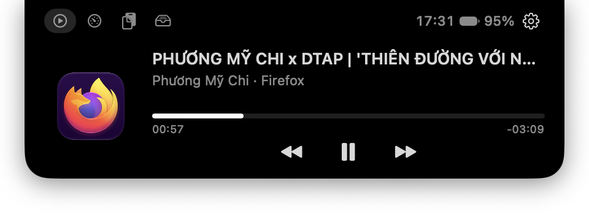
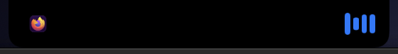

<div align="center">

# NotchDeck

**Turn the MacBook notch into something useful.**

Hover the notch and it opens into a small dashboard: now playing, system stats,
a focus timer, clipboard history and a file shelf. Move away and it tucks back
into the camera housing.

[**Download the latest release**](https://github.com/thanhphu2643/notchdeck/releases/latest) ·
macOS 14+ · Apple Silicon · MIT



</div>

## Features

### Now Playing, from any app

Spotify, Apple Music, YouTube in Chrome, Firefox or Safari, VLC, QuickTime: if
macOS knows it is playing, NotchDeck shows it. You get the title, artist, source
app, a live progress bar and previous / play-pause / next controls. Click the
artwork to jump to the app that is playing.

While something plays, the collapsed notch grows a little to show the artwork
and a live equalizer, so you can see what is on without opening anything:

<p align="center">
  
</p>

### System at a glance

CPU and memory usage, network down/up speed, battery and the clock.

### Focus timer

Start a 5, 25 or 50 minute timer. While it runs, the collapsed notch turns into
a live countdown, and a sound plays when time is up. You can pause or stop it at
any time.

### Clipboard history

The last 30 pieces of text you copied, one click to copy again. Anything a
password manager marks as concealed or transient
([nspasteboard.org](http://nspasteboard.org)) is never recorded.

### File shelf

Drag files onto the notch to park them, then drag them back out wherever you
need them. Double-click to open; right-click to reveal in Finder or remove.

### Small and unobtrusive

- The expanded panel is only 440 pt wide and sits right under the notch.
- No Dock icon. Settings and Quit are under the ⚙︎ in the notch and in the menu bar icon.
- **Launch at Login** is a single toggle.
- Works on Macs without a notch too: a slim pill hugs the menu bar instead.
- Needs no Accessibility, Screen Recording or other permissions.

## Install

1. Download `NotchDeck-x.y.z.dmg` from the
   [releases page](https://github.com/thanhphu2643/notchdeck/releases/latest).
2. Open it and drag **NotchDeck** into **Applications**.
3. The app is not notarized yet, so the first time you open it, right-click →
   **Open**. Or run:
   ```sh
   xattr -dr com.apple.quarantine /Applications/NotchDeck.app
   ```
4. Hover the notch. Turn on **Launch at Login** from the ⚙︎ if you like it.

## How it works

NotchDeck is a Swift app with a Rust core.

```
Sources/NotchDeck/   Swift: notch panel (AppKit), UI (SwiftUI), hover tracking,
                     pasteboard, battery, media commands
Sources/CNotchCore/  C header + module map that bridges to Rust
core/                Rust: system stats (sysinfo), now-playing state,
                     clipboard / shelf store, focus timer
```

- The Rust crate builds as a static library with a small C ABI (the `nd_*`
  functions in `core/src/lib.rs`). Data crosses the boundary as JSON, which
  Swift decodes with `Codable`.
- State is saved to `~/Library/Application Support/NotchDeck/state.json`.
- The panel is a borderless, non-activating `NSPanel` that sits above the menu
  bar. NotchDeck checks the cursor position instead of using global event
  monitors, so it needs no Accessibility permission, and dragging files onto
  the notch still works.

### Now Playing on macOS 15.4+

Since macOS 15.4, Apple only gives now-playing information to Apple-signed
processes. NotchDeck runs a small JavaScript for Automation loop inside
`/usr/bin/osascript` (see `NowPlaying.swift`). Once a second it reads
`MRNowPlayingRequest` and prints a JSON line when something changes. The Rust
core parses that line and estimates the playback position between updates.
Regular apps can still send media commands, so play/pause/next go straight
through MediaRemote.

## Build from source

Requirements: macOS 14+, Xcode command line tools (Swift 5.10+), Rust via
[rustup](https://rustup.rs).

```sh
scripts/bundle.sh                  # dist/NotchDeck.app
VERSION=0.1.0 scripts/dmg.sh       # dist/NotchDeck-0.1.0.dmg
open dist/NotchDeck.app
```

For development:

```sh
cargo build --release --manifest-path core/Cargo.toml
swift run
cargo test --manifest-path core/Cargo.toml
```

> Use rustup's toolchain rather than Homebrew's `rust`. Homebrew ships a
> standard library built for the newest macOS, so the app would not run on
> older systems. Point the scripts at rustup with
> `CARGO=~/.rustup/toolchains/stable-aarch64-apple-darwin/bin/cargo` if needed.

## Roadmap

- Seek by clicking the progress bar
- Calendar: next event
- Configurable tabs and timer presets
- Keyboard shortcut to open the panel
- Notarized builds

Issues and pull requests are welcome.

## License

[MIT](LICENSE) © 2026 Nguyễn Thanh Phú
